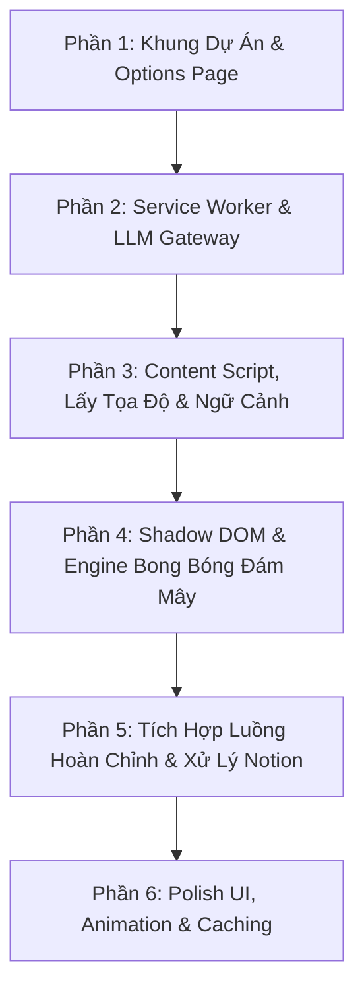

# Kế Hoạch Triển Khai Chi Tiết: Extension Tra Từ "Đám Mây" (Manifest V3)

> **Mục tiêu:** Xây dựng extension Chrome/Edge cho phép người dùng bôi đen từ trên mọi trang web (bao gồm cả Notion), chuột phải tra từ và hiển thị kết quả trực quan dưới dạng cụm bong bóng đám mây (Cloud Bubbles) quanh vùng bôi đen, tích hợp LLM hỗ trợ tự động nhận diện tiếng Anh và tiếng Nhật.

---

## 1. Thiết Kế Luồng Dữ Liệu & Giao Tiếp (Architecture & Protocols)

### 1.1 Sơ đồ tuần tự (Sequence Flow)
```
[User]           [Content Script]         [Service Worker]             [LLM API / Cache]
  │                     │                        │                             │
  ├─(Bôi đen & R-Click)─┼───────────────────────►│ (chrome.contextMenus)       │
  │                     │                        ├─ Kiểm tra cache local ─────►│
  │                     │◄── INIT_LOOKUP ────────┤                             │
  │                     │    (hiện Loading UI)   ├─ Gọi LLM (nếu cache miss) ─►│
  │                     ├── (lấy context câu)───►│                             │
  │                     │                        │◄── Nhận kết quả JSON ───────┤
  │                     │◄── RENDER_BUBBLES ─────┤ (lưu cache mới)             │
  │                     │    (cập nhật kết quả)  │                             │
  │◄── Hiện Cloud UI ───┤                        │                             │
```

### 1.2 Cấu trúc JSON Schema phản hồi từ LLM
```json
{
  "detected_lang": "ja" | "en",
  "word": "気配",
  "part_of_speech": "Danh từ",
  "reading": "けはい (kehai)",
  "meaning": "Cảm giác, linh cảm, dấu hiệu",
  "example": {
    "original": "人の気配がする。",
    "vietnamese": "Có cảm giác/dấu hiệu có người ở đây."
  }
}
```

### 1.3 Message Passing Protocol (Content Script ◄► Service Worker)
| Message Type | Sender | Payload | Mục đích |
|---|---|---|---|
| `CMD_INIT_LOOKUP` | Service Worker | `{ selectionText }` | Yêu cầu content script xác định tọa độ, trích xuất câu ngữ cảnh và bật bong bóng Loading. |
| `RESP_SELECTION_CONTEXT` | Content Script | `{ word, contextSentence, rect }` | Gửi câu ngữ cảnh xung quanh từ được bôi đen về cho Service Worker. |
| `CMD_RENDER_SUCCESS` | Service Worker | `{ data: DictResult }` | Đưa dữ liệu tra từ đã xử lý vào cụm bong bóng. |
| `CMD_RENDER_ERROR` | Service Worker | `{ errorMsg: string }` | Thông báo lỗi (hết quota, mất mạng, lỗi API key) lên bong bóng. |

---

## 2. Phân Chia Giai Đoạn Triển Khai (Phased Roadmap)



### Phần 1: Khung Dự Án, Manifest & Options Page
* **Nhiệm vụ:**
  1. Khởi tạo `manifest.json` chuẩn MV3:
     - Permissions: `contextMenus`, `storage`, `activeTab`.
     - Host Permissions: `<all_urls>` (để gọi LLM và inject script).
     - Content scripts: Matches `<all_urls>`, `all_frames: true` (để hỗ trợ iframe/Notion embed).
  2. Xây dựng `options.html` + `options.js`:
     - Nhập API Key (Hỗ trợ Gemini Flash hoặc OpenAI/Groq).
     - Lựa chọn nhà cung cấp model (Gemini 2.5 Flash / GPT-4o-mini).
     - Nút "Kiểm tra kết nối" (Test Connection) để người dùng biết key hợp lệ ngay trên trang Options.
     - Lưu cấu hình vào `chrome.storage.sync`.

### Phần 2: Service Worker & Tích hợp LLM Gateway
* **Nhiệm vụ:**
  1. Đăng ký menu ngữ cảnh: `chrome.contextMenus.create`.
  2. Xây dựng module `llm-service.js` trong Service Worker:
     - Viết System Prompt tối ưu: tự động nhận diện ngôn ngữ (EN/JA), giải thích ngữ cảnh, bắt buộc trả về định dạng JSON thuần không bọc rác.
     - Fetch API với timeout, xử lý lỗi mạng / sai API key.
  3. Xây dựng module `cache-service.js`:
     - Lưu kết quả tra cứu vào `chrome.storage.local` với khóa chuẩn hóa (vd: `cache_${lang}_${word}`).
     - Giới hạn tối đa số từ cache (LRU hoặc dọn dẹp định kỳ).

### Phần 3: Content Script - Trích Xuất Vùng Chọn & Ngữ Cảnh
* **Nhiệm vụ:**
  1. Xác định tọa độ chính xác:
     - Dùng `window.getSelection().getRangeAt(0).getBoundingClientRect()`.
     - Cộng độ lệch cuộn trang (`window.scrollX`, `window.scrollY`) để định vị tuyệt đối.
  2. Thuật toán trích xuất câu ngữ cảnh (Context Extractor):
     - Lấy text node cha của vùng chọn.
     - Tìm dấu kết thúc câu gần nhất phía trước và phía sau (`.` `?` `!` `。` `！` `？` hoặc ranh giới đoạn block/newline).
     - Gửi câu này về LLM để dịch đúng nghĩa theo văn cảnh thay vì dịch nghĩa gốc từ điển.

### Phần 4: Shadow DOM & Engine Hiển Thị Bong Bóng Đám Mây
* **Nhiệm vụ:**
  1. Tạo Shadow Host độc lập:
     - Tạo `<div id="word-cloud-dict-root">`, gán `attachShadow({ mode: 'open' })`.
     - Nhúng `bubbles.css` độc lập vào Shadow Root để triệt tiêu mọi xung đột style từ trang web bên ngoài.
  2. Thiết kế bố cục cụm bong bóng (Cloud Layout Algorithm):
     - Vị trí trung tâm: Từ bôi đen.
     - **Bong bóng 1 (Phát âm / Romaji):** Nằm chếch phía trên bên trái (nhỏ, thanh lịch).
     - **Bong bóng 2 (Từ loại):** Nằm chếch phía trên bên phải (tag gọn, màu badge).
     - **Bong bóng 3 (Nghĩa tiếng Việt):** Nằm chính giữa bên dưới/phải (nổi bật nhất, font đậm rõ nét).
     - **Bong bóng 4 (Câu ví dụ & Dịch):** Nằm dưới cùng (dạng bong bóng thoại mềm mại).
  3. Thuật toán chống tràn màn hình (Viewport Boundary Protection):
     - Tự động đảo chiều các bong bóng lên trên nếu từ bôi đen nằm sát mép dưới màn hình.
     - Tự động co lùi về trái nếu từ bôi đen nằm sát mép phải màn hình.
  4. Quản lý trạng thái vòng đời UI:
     - State Loading: Các bong bóng skeleton mờ, animation gợn sóng (pulse).
     - State Ready: Bung nở ra với hiệu ứng nảy nhẹ (spring/fade-in).
     - Tự đóng khi click ra ngoài (`click outside`) hoặc nhấn phím `Escape`.

### Phần 5: Tích Hợp Luồng Đầy Đủ & Xử Lý Trường Hợp Đặc Thù
* **Nhiệm vụ:**
  1. Kết nối hoàn chỉnh: Click menu -> Bắn message -> Hiện loading -> LLM trả về -> Render kết quả.
  2. Kiểm thử và tinh chỉnh riêng trên **Notion**:
     - Xử lý các khối `contenteditable` và cấu trúc DOM nhiều lớp của Notion.
     - Đảm bảo click chuột phải trên Notion vẫn kích hoạt đúng selection.
  3. Xử lý trường hợp bôi đen trong `<iframe>`.

### Phần 6: Tinh Chỉnh Mỹ Thuật (Polish) & Tối Ưu Trải Nghiệm
* **Nhiệm vụ:**
  1. Áp dụng phong cách thiết kế hiện đại: Glassmorphism (nền kính mờ `backdrop-filter: blur`), đổ bóng nhiều tầng (layered soft shadows), gradient viền tinh tế.
  2. Micro-interactions: Rê chuột vào từng bong bóng có hiệu ứng nổi nhẹ (hover scale).
  3. Nút tiện ích nhỏ trên bong bóng: Nút copy nghĩa, nút phát âm (dùng Web Speech API `speechSynthesis`).

---

## 3. Tiêu Chí Nghiệm Thu (Acceptance Criteria) Cho MVP
- [ ] Bôi đen 1 từ tiếng Anh hoặc tiếng Nhật trên bất kỳ trang web nào (bao gồm Notion), click chuột phải thấy mục "Tra đám mây".
- [ ] Ngay khi click, cụm bong bóng loading xuất hiện chính xác quanh từ vừa chọn.
- [ ] Dưới 2 giây (với Gemini Flash), 4 bong bóng hiện rõ: Từ loại, Cách đọc/Romaji, Nghĩa tiếng Việt, Câu ví dụ ngữ cảnh.
- [ ] Không bị lỗi CSS vỡ layout trên các trang web có phong cách giao diện khác nhau (Dark mode, Light mode).
- [ ] Tra lại cùng một từ trong cùng câu -> kết quả nạp ngay lập tức từ Cache mà không tốn gọi API.
